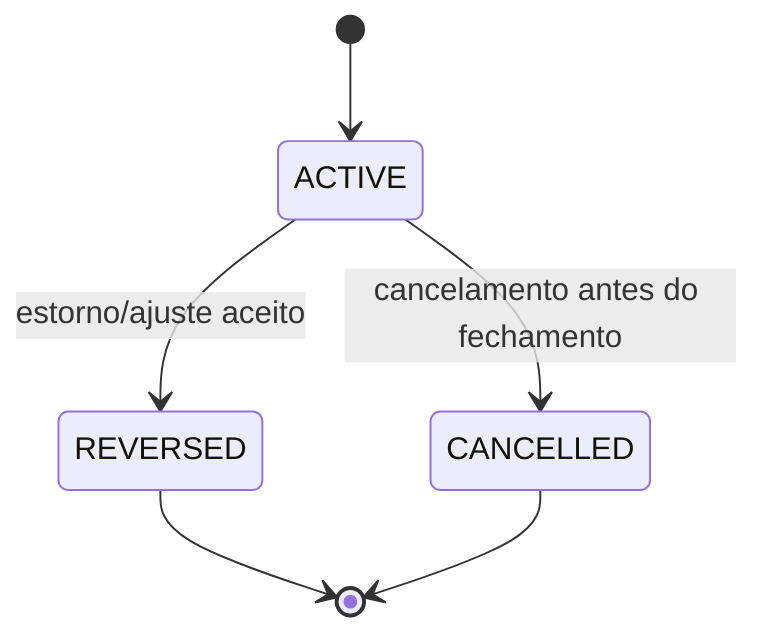
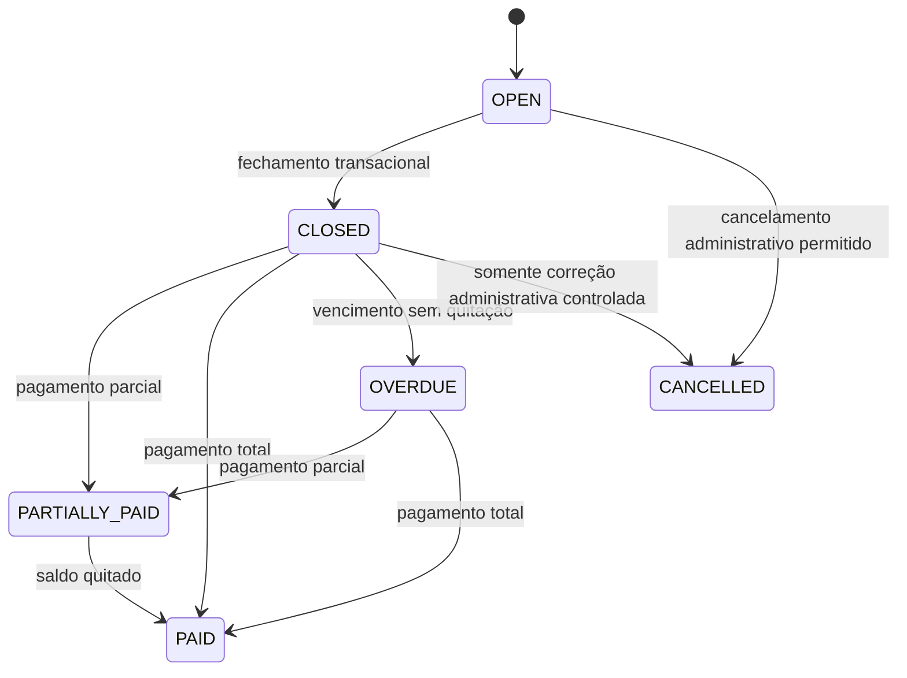
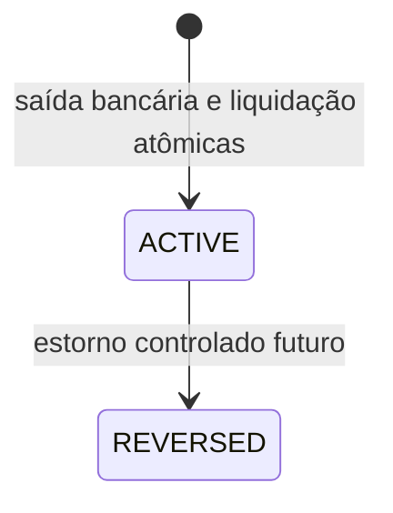

# ADR 0011 — Arquitetura de Cartões de Crédito

## Status

**Aceito para a Sprint 8.** Arquitetura definida para a TASK-8.0; não implementa código, migrations ou endpoints.

**Gate:** READY FOR TASK-8.1.

## Contexto

O Equilibra possui um ledger operacional unificado em `FinancialTransaction`. Uma despesa convencional exige uma `AssetAccount` de origem e reduz imediatamente o saldo derivado dessa conta. Cartão de crédito possui semântica diferente: a compra gera uma despesa econômica e uma obrigação perante o emissor, mas não é saída de caixa bancário naquele instante.

A compra e o pagamento da fatura precisam permanecer separados:

```text
compra no cartão  -> despesa econômica + obrigação + consumo de limite
pagamento fatura  -> saída bancária + liquidação da obrigação
```

Misturar esses eventos produziria saldo bancário incorreto, duplicação em relatórios/orçamentos e dupla contagem na projeção de caixa.

Este ADR é compatível com:

- `docs/adr/0002-financial-ledger-architecture.md`;
- ADRs `0006` a `0010`, sobre previsibilidade, compromissos, projeção e relatórios;
- `docs/quality/task-7.8-sprint-7-gate.md`, que aprovou a Sprint 7.

## Escopo e não escopo

### Incluído

- Cartão de crédito como agregado privado próprio.
- Compras à vista e parceladas.
- Faturas, fechamento, vencimento e pagamentos.
- Limite, obrigação, estorno e reconciliação.
- Integração conceitual com ledger, categorias, orçamentos, relatórios e projeção.
- Ownership, concorrência, idempotência e migração incremental.

### Fora do MVP

- Multi-moeda.
- Integração automática com emissores/bancos.
- Importação de arquivos de fatura.
- Juros rotativos, multa, encargos, CET e cálculo de pagamento mínimo.
- Contestação com workflow externo.
- Cashback, pontos, anuidade e benefícios.
- Alteração de parcelamento depois da compra.
- Fatura rotativa entre ciclos.

Juros, multa, encargos e pagamento mínimo não serão inventados no MVP. Se surgirem como requisito, deverão ser modelados como eventos financeiros distintos em ADR posterior.

## Terminologia

- **Cartão:** instrumento de crédito, não conta bancária.
- **Compra:** evento econômico que possui categoria, valor e obrigação.
- **Parcela:** parte da compra alocada a uma fatura.
- **Fatura:** conjunto de parcelas com mesmo cartão e ciclo de fechamento.
- **Obrigação:** saldo ainda não liquidado originado de compras, parcelas e ajustes permitidos.
- **Pagamento:** saída de uma `AssetAccount` para liquidar uma fatura; não é nova despesa econômica.
- **Limite comprometido:** obrigação ainda não liberada conforme a política do cartão.
- **Limite disponível:** limite total menos o limite comprometido e menos reservas aplicáveis.

## Decisões

### 1. `CreditCard` é entidade própria

`CreditCard` não é subtipo nem instância de `AssetAccount`. Uma `AssetAccount` representa caixa ou patrimônio líquido disponível; um cartão representa crédito concedido por terceiro.

A entidade deverá conter, no mínimo:

- `id` UUID;
- `ownerId` imutável;
- `name` nome exibido obrigatório;
- `institution` instituição emissora obrigatória;
- `nickname` apelido opcional;
- `totalLimit` `BigDecimal` positivo;
- `closingDay` entre 1 e 31;
- `dueDay` entre 1 e 31;
- `status` (`ACTIVE`, `INACTIVE`);
- `timezone` IANA explícito, com default de produto `America/Sao_Paulo` no cadastro quando não informado;
- `createdAt`, `updatedAt` como `Instant`;
- `version` para concorrência otimista.

Número completo, CVV, senha, token e credenciais do emissor não serão armazenados. Os quatro últimos dígitos poderão ser adicionados futuramente como dado de exibição, sem permitir autenticação.

Cartão inativo não aceita novas compras nem novos pagamentos iniciados pelo cartão, mas permanece consultável para histórico, faturas e relatórios.

### 2. Cartões no seletor de origem

O formulário de despesa terá um seletor conceitual de origem com dois tipos:

```text
BANK_ACCOUNT -> AssetAccount
CREDIT_CARD  -> CreditCard
```

O request não receberá `userId` nem um identificador ambíguo. A aplicação validará o tipo e carregará a origem por `id + ownerId`.

Quando a origem for `BANK_ACCOUNT`, aplica-se o fluxo atual de `Expense` e o ledger reduz a conta imediatamente. Quando for `CREDIT_CARD`, o caso de uso de compra de cartão cria a despesa econômica e a obrigação, sem preencher `source_account_id` bancário e sem alterar saldo de `AssetAccount`.

Não será usado um cartão falso como `AssetAccount`, nem um `source_account_id` apontando para cartão.

### 3. Modelo de domínio

Os nomes abaixo são canônicos para o desenho; a implementação poderá usar nomes equivalentes apenas se preservar as mesmas responsabilidades.

#### `CreditCardPurchase`

- `id`, `ownerId`, `creditCardId`;
- `description`, `categoryId`, `amount`;
- `purchaseDate` como `LocalDate` civil no timezone do cartão;
- `status`: `ACTIVE`, `REVERSED`, `CANCELLED`;
- `installmentCount`, sempre 1 ou maior;
- `createdAt`, `updatedAt`, `version`;
- referência à despesa econômica no formato escolhido pela TASK-8.1.

O valor da compra é positivo, com `DECIMAL(19,2)`. O valor total é preservado; parcelas não alteram o total econômico.

#### `CreditCardInstallment`

- `id`, `ownerId`, `purchaseId`, `creditCardId`;
- `sequenceNumber`, `totalInstallments`;
- `principalAmount`;
- `statementId`;
- status derivado da compra e da fatura.

Para evitar erro de arredondamento, o valor das parcelas será calculado em centavos: parcelas iniciais recebem o eventual resto e a soma deve ser exatamente o valor total da compra.

#### `CreditCardStatement`

- `id`, `ownerId`, `creditCardId`;
- `cycleStart`, `cycleEnd`, `closingAt`, `dueDate` como datas civis/instantes derivados;
- `status`: `OPEN`, `CLOSED`, `OVERDUE`, `PARTIALLY_PAID`, `PAID`, `CANCELLED`;
- `totalAmount`, `paidAmount`, `outstandingAmount`;
- `closedAt`, `createdAt`, `updatedAt`, `version`.

`OVERDUE` é derivado ou materializado apenas quando necessário; não é uma nova dívida. `PARTIALLY_PAID` e `PAID` são estados de liquidação. Uma fatura não é reaberta depois de fechada; correções ocorrem por estorno/ajuste rastreável.

#### `StatementPayment`

- `id`, `ownerId`, `statementId`, `bankAccountId`;
- `amount` positivo;
- `paidAt` como `Instant`;
- `status`: `ACTIVE`, `REVERSED`;
- `financialTransactionId` do movimento bancário;
- chave de idempotência opcional e `version`.

Cada pagamento gera exatamente uma saída bancária para a conta escolhida. O pagamento não possui `categoryId` de despesa econômica e não é contabilizado novamente no orçamento.

### 4. Limite

No MVP, a política é:

```text
availableLimit = totalLimit - committedLimit - reservedLimit
```

Para uma compra parcelada, o valor total da compra compromete imediatamente o limite, mesmo que somente a primeira parcela apareça na fatura atual. Cada pagamento do principal libera o valor correspondente pago. Estornos liberam o principal ainda comprometido.

- `committedLimit`: principal de compras ativas ainda não liquidado;
- `reservedLimit`: reserva explícita para operações futuras; começa em zero no MVP e não será criada sem caso de uso;
- `availableLimit` nunca pode ser negativo após uma compra aceita;
- limite excedido retorna conflito e não persiste compra, parcela ou despesa.

A implementação poderá derivar esses valores por consulta agregada; não deve criar uma segunda fonte mutável sem necessidade de desempenho comprovada.

### 5. Ciclos, datas e timezone

A data da compra é civil no timezone do cartão. O backend persistirá a data civil da compra e instantes técnicos em UTC. Não se usará o timezone do servidor para decidir a fatura.

Regra do fechamento:

- se `purchaseDate.dayOfMonth < closingDay`, a compra pertence ao ciclo que fecha no `closingDay` daquele mês;
- se `purchaseDate.dayOfMonth >= closingDay`, pertence ao ciclo que fecha no `closingDay` do mês seguinte;
- compra exatamente no dia do fechamento pertence ao ciclo seguinte, pois o fechamento do dia é considerado ocorrido antes de novas compras daquele dia;
- a API poderá aceitar um horário explícito para resolver uma futura necessidade intradiária, mas o MVP usa a regra civil determinística acima.

Dias 29, 30 e 31 inexistentes usam o último dia válido do mês. O vencimento aplica a mesma normalização. Ano bissexto segue o calendário gregoriano de `java.time`.

A fatura é criada/derivada para o ciclo correspondente. O `cycleEnd` é inclusivo para a data civil; a consulta de parcelas usa intervalo técnico `[start, nextStart)` para evitar ambiguidade.

### 6. Fechamento

O fechamento será um caso de uso explícito, seguro para execução automática futura. Não haverá scheduler obrigatório na TASK-8.1.

Ao fechar:

1. localizar a fatura `OPEN` por `id + ownerId`;
2. selecionar parcelas elegíveis do ciclo;
3. congelar sua associação à fatura;
4. calcular total e vencimento;
5. alterar para `CLOSED`;
6. executar dentro de transação e lock;
7. repetir a chamada sobre fatura já fechada como operação idempotente, retornando o mesmo resultado.

Não é permitido duas faturas ativas para o mesmo cartão e ciclo. Unique constraint e locking devem proteger concorrência.

### 7. Pagamentos

O MVP permite pagamento total e parcial.

- pagamento parcial aumenta `paidAmount` e leva a `PARTIALLY_PAID`;
- pagamento que alcança o saldo leva a `PAID`;
- pagamento acima do saldo é rejeitado com conflito; não haverá crédito excedente implícito;
- pagamento duplicado identificado por fatura, valor, conta e chave de idempotência quando fornecida não pode gerar segunda saída;
- uma tentativa concorrente deve ser serializada por lock/versão;
- apenas uma fatura do owner pode ser paga e apenas por uma `AssetAccount` do mesmo owner;
- a conta bancária deve estar ativa no momento do pagamento;
- cada pagamento aceito cria uma `FinancialTransaction` de saída bancária, com metadado que indique pagamento de fatura, sem nova despesa econômica.

Se uma transação bancária for criada e a liquidação falhar, toda a operação será revertida por `@Transactional`. Reconciliação posterior deverá detectar inconsistência, não mascará-la com novo débito.

### 8. Juros, multas e pagamento mínimo

Ficam fora do MVP. O saldo da fatura é exclusivamente a soma das parcelas e ajustes de principal permitidos. A ausência desses recursos deve ser explícita na API e na documentação, sem campos que aparentem suportá-los.

### 9. Estorno, reembolso, contestação e edição

- Antes do fechamento: compra ativa pode ser cancelada/estornada por caso de uso próprio; parcelas são anuladas e o limite é liberado.
- Depois do fechamento: não editar silenciosamente valor, data, cartão ou parcelas. Criar evento de estorno/ajuste rastreável; o valor original permanece no histórico.
- Compra paga não é excluída fisicamente.
- Reembolso no MVP será tratado como crédito/ajuste explícito vinculado à compra, sem apagar a despesa original; se não houver requisito de implementação, permanece fora da TASK-8.1.
- Contestação é apenas estado/registro futuro, sem workflow externo.
- Uma compra cancelada não cria novo movimento bancário.

### 10. Integração com despesa, orçamento e relatórios

A compra no cartão conta uma única vez como despesa econômica por categoria, na data da compra ou na política de competência definida pela TASK-8.1. Recomenda-se data da compra para o MVP.

O pagamento da fatura:

- reduz o saldo da `AssetAccount` escolhida;
- aparece como saída de caixa e no histórico de movimentação;
- não entra novamente nos totais de despesa por categoria;
- não reduz orçamento pela segunda vez;
- deve ser identificável como `STATEMENT_PAYMENT` nos relatórios.

Relatórios devem oferecer separação explícita entre:

```text
expensesByCategory = compras econômicas
cashOutflows       = saídas bancárias, incluindo pagamentos
cardObligations    = principal aberto/fechado ainda não pago
```

A arquitetura não altera retroativamente o significado de `FinancialTransaction` convencional.

### 11. Compromissos e projeção

Uma compra no cartão não cria um compromisso bancário futuro para cada parcela. As parcelas são obrigações da fatura.

Para projeção de caixa, somente o pagamento esperado da fatura pode reduzir uma conta bancária. A integração futura deve escolher uma das formas abaixo, sem combinar ambas:

- derivar eventos de pagamento de fatura a partir de faturas fechadas e sua data de vencimento; ou
- materializar um `FinancialCommitment` de tipo pagamento de fatura com referência exclusiva à fatura.

A decisão desta ADR é usar a derivação/materialização como evento de caixa, mas nunca projetar simultaneamente parcela e pagamento. `FinancialCommitment` existente não deve receber uma `AssetAccount` para cada compra de cartão, pois isso anteciparia uma saída inexistente.

Faturas já pagas não entram na projeção. Pagamentos efetivados não duplicam o ledger.

### 12. Cartões inativos e saldo inicial

Inativar cartão bloqueia novas compras, fechamento de novas operações e criação de pagamentos pelo cartão, mas não cancela compras ou faturas existentes. Faturas abertas devem ser encerradas por fluxo explícito antes de eventual encerramento definitivo.

Para cartões cadastrados com histórico anterior ao sistema, o MVP oferece saldo inicial por meio de uma operação de abertura:

- `initialOutstandingAmount` positivo;
- data de referência;
- primeira fatura aberta ou ajuste inicial rastreável;
- sem criar despesa econômica histórica no orçamento atual;
- sem reduzir conta bancária;
- limite disponível já considera o saldo inicial.

Esse saldo não poderá ser alterado silenciosamente depois de haver compras/pagamentos. Correção futura será ajuste explícito auditável.

### 13. Ownership

Todas as entidades carregam `ownerId` imutável. O owner vem exclusivamente de `CurrentUser.id()`.

Consultas obrigatoriamente usarão padrões como:

```text
findByIdAndOwnerId
findAllByOwnerId
findStatementByIdAndOwnerId
```

Nenhum request aceitará `ownerId` ou `userId` como fonte de autorização. Cartão, compra, fatura, parcela, pagamento, conta bancária e categoria referenciados devem pertencer ao mesmo owner. Recurso de outro owner retorna `404` quando apropriado.

## Máquina de estados

### Compra



### Fatura



`OVERDUE` pode ser derivado de `dueDate < hoje` e saldo pendente; sua materialização não deve criar evento econômico.

### Pagamento



## Matriz de impacto financeiro

| Evento | Despesa econômica | Obrigação cartão | Limite disponível | Saldo bancário | Orçamento | Projeção |
|---|---:|---:|---:|---:|---:|---:|
| Compra à vista | + | + | − | 0 | + | 0 |
| Compra parcelada | + total | + total | − total | 0 | + total na política escolhida | 0 |
| Fechamento | 0 | 0 | 0 | 0 | 0 | 0 |
| Pagamento parcial | 0 | − pagamento | + principal pago | − valor pago | 0 | remove evento pago |
| Pagamento total | 0 | − saldo | + saldo | − valor pago | 0 | remove evento pago |
| Estorno antes do fechamento | − obrigação original | − | + | 0 | − | 0 |
| Estorno pós-fechamento | correção/ajuste | − ajuste | + ajuste | 0, salvo reembolso | − ajuste | recalcula evento |
| Compra bancária convencional | + | 0 | 0 | − | + | 0 |

## Contratos REST conceituais

Os contratos definitivos serão detalhados nas TASKS 8.1–8.3. A API deve manter request/response separados, paginação e `ProblemDetail`.

```text
POST   /api/credit-cards
GET    /api/credit-cards?page=&size=&status=
GET    /api/credit-cards/{id}
PUT    /api/credit-cards/{id}
PATCH  /api/credit-cards/{id}/status
GET    /api/credit-cards/{id}/limit
POST   /api/credit-cards/{id}/purchases
GET    /api/credit-cards/{id}/purchases?page=&size=&from=&to=&status=
GET    /api/credit-card-purchases/{id}
POST   /api/credit-card-purchases/{id}/reverse
GET    /api/credit-cards/{id}/statements?page=&size=&status=
GET    /api/credit-card-statements/{id}
POST   /api/credit-card-statements/{id}/close
POST   /api/credit-card-statements/{id}/payments
GET    /api/credit-card-statements/{id}/payments?page=&size=
```

Nenhum endpoint aceita owner no path ou payload. Valores são strings decimais conforme convenção da API, e datas/instantes usam formatos explícitos.

## Persistência e migração

A implementação deverá usar migrations Flyway novas, sem modificar migrations aplicadas. Ordem recomendada:

1. `credit_cards`;
2. `credit_card_purchases`;
3. `credit_card_installments`;
4. `credit_card_statements`;
5. `statement_payments`;
6. tabelas de vínculo/ajuste e índices adicionais, se necessários.

Todas as tabelas devem usar InnoDB, UTF-8, UUIDs string consistentes, foreign keys para owner e entidades relacionadas, `DECIMAL(19,2)` para valores e `CHECK` para valores positivos e estados válidos.

Índices mínimos:

- `(owner_id, status)` em cartões, compras, faturas e pagamentos;
- `(owner_id, credit_card_id, purchase_date)`;
- `(owner_id, credit_card_id, cycle_start, cycle_end)`;
- `(owner_id, credit_card_id, due_date)`;
- `(owner_id, statement_id, paid_at)`;
- unicidade de ciclo por `(owner_id, credit_card_id, cycle_start, cycle_end)`;
- unicidade de parcela por `(purchase_id, sequence_number)`;
- unicidade do vínculo de pagamento com transação bancária;
- unicidade de efetivação/fechamento onde o fluxo exigir idempotência.

Registros existentes de `AssetAccount` e `FinancialTransaction` permanecem inalterados. Não haverá migração automática de despesas existentes para cartões sem dados confiáveis. Um cartão novo começa sem obrigação, salvo a operação explícita de saldo inicial.

## Concorrência e idempotência

- `@Transactional` na camada de aplicação para compra, fechamento, pagamento e estorno.
- `@Version` nas entidades mutáveis.
- Lock pessimista ou equivalente no cartão/fatura durante reserva de limite e pagamento.
- Verificar limite e persistir compra na mesma transação.
- Fechamento repetido retorna o fechamento já existente.
- Pagamento repetido não cria nova `FinancialTransaction`.
- A criação de saída bancária e a atualização de `StatementPayment` são atômicas.
- `Idempotency-Key` será obrigatório para integrações/retries externos quando a API pública de pagamento for implementada; até lá, constraint e vínculo único são a proteção mínima.

## Cenários golden

1. Conta A = 1.000,00, cartão limite = 5.000,00, compra = 200,00: conta continua 1.000,00, obrigação = 200,00 e limite disponível = 4.800,00.
2. Pagamento de 200,00 pela conta A: conta = 800,00, obrigação quitada, limite = 5.000,00, sem segunda despesa.
3. Compra de 1.200,00 em 3 parcelas de 400,00: 1.200,00 comprometidos imediatamente; uma parcela na fatura aplicável; parcelas futuras em faturas subsequentes; orçamento conta a compra uma vez.
4. Compras em lados opostos do fechamento pertencem a faturas diferentes.
5. Compra no dia do fechamento pertence ao ciclo seguinte.
6. Fechamento repetido não duplica fatura nem parcela.
7. Pagamento repetido não gera débito bancário duplicado.
8. Pagamento parcial reduz obrigação e limite proporcionalmente; excedente é rejeitado.
9. Estorno libera limite sem reduzir conta bancária.
10. Compra de User A nunca aparece para User B.
11. Compra com cartão inativo é rejeitada; histórico continua consultável.
12. Cartão com saldo inicial mostra limite comprometido sem criar despesa histórica ou saída bancária.
13. Fatura paga não aparece novamente como evento de projeção.
14. Pagamento aparece como saída de caixa, mas não como nova despesa por categoria.
15. Compra parcelada com valor não divisível em centavos preserva soma exata das parcelas.

## Alternativas rejeitadas

### Modelar cartão como `AssetAccount`

Rejeitado: compra reduziria saldo bancário, confundiria patrimônio com crédito e permitiria seleção de uma entidade de natureza errada.

### Criar uma despesa bancária no momento da compra

Rejeitado: viola o princípio financeiro e duplica a saída quando a fatura for paga.

### Criar uma despesa por parcela

Rejeitado como modelo econômico principal: orçamento e relatórios contariam a mesma compra várias vezes. Parcelas são obrigações de pagamento, não novas compras.

### Somar compras e pagamentos no mesmo KPI de despesas

Rejeitado: mistura competência econômica com caixa e impede reconciliação.

### Persistir somente limite disponível mutável

Rejeitado: cria segunda fonte de verdade e é vulnerável a concorrência; o limite deve ser derivável das obrigações/reservas.

### Reabrir fatura fechada para qualquer edição

Rejeitado: altera histórico e pode perder reconciliação. Correções serão eventos explícitos.

## Riscos

- **Alto:** dupla contagem na projeção se parcelas e pagamento forem projetados simultaneamente. Mitigação: uma única representação de evento de caixa.
- **Alto:** corrida entre compras pode ultrapassar limite. Mitigação: transação, locking e constraint.
- **Alto:** pagamento duplicado pode debitar conta duas vezes. Mitigação: vínculo único, versão, lock e idempotência.
- **Alto:** cross-owner em cartão, conta ou categoria. Mitigação: `CurrentUser` e queries ownership-aware.
- **Médio:** divergência entre data civil e instante. Mitigação: timezone persistido e regras com `LocalDate`.
- **Médio:** arredondamento de parcelas. Mitigação: cálculo em centavos e soma exata.
- **Médio:** histórico anterior ao sistema sem faturas detalhadas. Mitigação: saldo inicial explícito e não retroativo.
- **Baixo:** custo de agregação de limite. Mitigação: medir antes de introduzir snapshots.

## Refinamento das TASKS 8.1–8.8

- **TASK-8.1 — Modelo e persistência:** entidades, enums, migrations, constraints, índices, saldo inicial e testes de domínio.
- **TASK-8.2 — Casos de uso de cartões e compras:** CRUD owner-scoped, limite, compra à vista/parcelada, categorias, estorno e concorrência.
- **TASK-8.3 — Faturas e calendário:** geração/derivação de ciclos, fechamento idempotente, datas 29/30/31, vencimento e estados.
- **TASK-8.4 — Pagamentos:** pagamento total/parcial, saída bancária atômica, idempotência, limite liberado e reconciliação.
- **TASK-8.5 — Integração financeira:** ledger, histórico, orçamento, relatórios, Dashboard e separação despesa versus caixa.
- **TASK-8.6 — Projeção e compromissos:** eventos de vencimento de fatura sem dupla contagem, cartões inativos e integração consultiva.
- **TASK-8.7 — Interface:** seletor de origem, telas de cartões/faturas/compras/pagamentos, acessibilidade e responsividade.
- **TASK-8.8 — Gate:** testes unitários, integração MySQL/Testcontainers, E2E, segurança, concorrência, regressão de relatórios e validação dos golden scenarios.

## Decisões pendentes futuras

Nenhuma decisão essencial impede a TASK-8.1. Permanecem para refinamento de produto, sem bloquear o modelo:

- política de competência de compra em relatórios mensais;
- UX e prazo de retenção de faturas canceladas;
- workflow de reembolso e contestação;
- juros, multa, encargos, mínimo e rotativo;
- integração automática com emissor;
- snapshots de limite após medição de volume.

## Consequências

O modelo preserva a distinção entre obrigação de crédito e caixa bancário, mantém o ledger existente íntegro e permite relatórios que conciliam competência econômica e saídas reais. Em contrapartida, exige novos agregados, regras de calendário, locks, idempotência e consultas específicas de limite e fatura.

A compra no cartão nunca reduz saldo bancário. O pagamento da fatura nunca é uma nova despesa econômica. Essas duas regras são invariantes de aceitação para toda implementação da Sprint 8.

## Gate final

**READY FOR TASK-8.1 — Modelo e persistência de cartões de crédito.**
